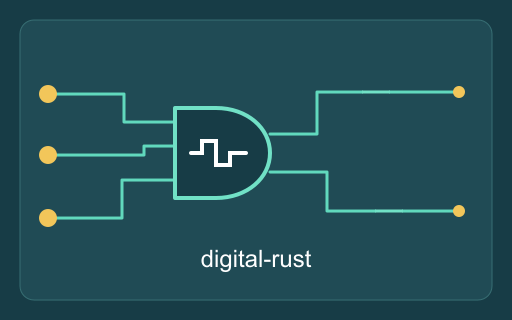

# Digital Rewrite




An early Rust rewrite of [Digital](https://github.com/hneemann/Digital), with PhotoCraft as the architectural source and MaterialCraft as UI inspiration. Digital defines behavior; this project is not yet Digital-compatible or feature-complete. The native egui editor supports a bounded component/editing subset and a one-bit simulator. See [`reimplementation/docs/parity.md`](reimplementation/docs/parity.md) for current status and [`reimplementation/docs/wiring.md`](reimplementation/docs/wiring.md) for the authoritative endpoint-only connectivity rules.

## Headless CLI

The separate `digital-rust-cli` binary is Rust-specific and does not emulate Digital's Java CLI. It reads but never writes its input document:

```sh
cargo run --locked --manifest-path reimplementation/Cargo.toml --bin digital-rust-cli -- open PATH
cargo run --locked --manifest-path reimplementation/Cargo.toml --bin digital-rust-cli -- validate PATH
cargo run --locked --manifest-path reimplementation/Cargo.toml --bin digital-rust-cli -- simulate PATH --input 'ID=0|1' [--input 'ID=0|1' ...] [--budget N]
```

`open` reports parsed component/segment records but does not validate connectivity. `validate` compiles the supported one-bit subset. `simulate` accepts input component IDs shown by `open`, settles startup and each assignment in order, and reports outputs only after all work succeeds. The cumulative work budget defaults to 20,000 and accepts 1–80,000; up to 10,000 input assignments are accepted. `--seed N` and `--oscillation-limit N` configure simulator startup/detection; the default seed is 0. Exit codes are 0 on success, 1 on document/compile/simulation/budget failure, and 2 on usage or assignment syntax error. Failure diagnostics go to stderr; failed simulation emits no output rows. Only the strict `.dig` v2 subset is accepted. Supported operations are headless, one-bit and bounded; feedback is accepted by compilation but settling may fail. This is not Digital CLI compatibility.

## Quickstart

Install a Rust toolchain supporting edition 2024, Cargo, and optionally [just](https://just.systems/). A native window system and wgpu-compatible graphics backend are required; Linux builds also require the usual Wayland/X11 development libraries.

```sh
just run-rust
just build-rust
just check-rust
```

Without just, launch the native editor with `cargo run --locked --manifest-path reimplementation/Cargo.toml`. `just run` still launches the bundled Java reference using its machine-specific Java path. `build_reimplemtation` remains an alias for `build-rust`.

## macOS app bundle

```sh
just bundle-macos     # builds target/bundle/digital-rust.app
just open-macos       # builds if needed, then opens it
just check-bundle-macos
```

`reimplementation/scripts/bundle-macos.sh` (macOS only; requires `jq`, `iconutil`, `codesign`, `plutil`) runs `cargo build --release --locked` (Cargo itself writes to `reimplementation/target`; the script takes the binary and generated-asset paths from Cargo's JSON build messages) and assembles `Contents/MacOS/digital-rust`, `Contents/Info.plist` (version from `reimplementation/Cargo.toml`) and `Contents/Resources/AppIcon.icns`. The icon is derived at bundle time from the build-generated app-icon PNGs through an `.iconset` and `iconutil`; neither PNGs nor `.icns` files are committed. The 512@2x slot is omitted because no 1024 px image is generated. Rerunning replaces the previous bundle: the new one is staged and signed in a temporary sibling directory of the destination, the old one is moved aside, and it is restored if installation fails or the run is interrupted. `check-bundle-macos` builds the bundle repeatedly, forces the install step to fail (test hook `BUNDLE_MACOS_TEST_FAIL_INSTALL`, inert unless set) to assert the previous bundle survives with no leftovers, and asserts the executable bit, `plutil -lint`, an `iconutil` round trip of the icon, `codesign --verify`, and that the binary is a Mach-O linking libSystem; no GUI is launched.

The bundle is ad-hoc signed (`codesign --sign -`) so it runs locally; set `CODESIGN_IDENTITY` to use a real identity. It is not notarized, so Gatekeeper may block a copy downloaded or transferred to another Mac. There is no DMG, and the binary targets the host architecture only (no universal binary). The bundle identifier `io.github.digital-rust.editor` and the name `digital-rust` are provisional working names, and `LSMinimumSystemVersion` (11.0) is declared, not tested on older systems.

## Structure and dependencies

The single package in `reimplementation/` contains `domain` (documents and signals), `components` (definitions and simulation), `formats` (file I/O), and `engine` (sessions and commands); component documents, editing history, a pin-net compiler (`simulation`) and a bounded one-bit runtime (`runtime`) are implemented; `sim_text` renders diagnostics for the UI. `ui` is the native adapter and `main.rs` bootstraps it; `symbols` (generated vector data), `symbol_tessellate`, `symbol_render` and `canvas` draw and pick components without involving the engine. Toolkit-independent layers must not depend on the UI.

Published eframe 0.31 supplies egui and wgpu, default fonts, accessibility, and X11/Wayland support. It avoids MaterialCraft's forked egui/winit patch set and widgets. `lyon_tessellation` (pinned to 1.0.23, `std` only) tessellates compound symbol fills and strokes, which epaint's convex-only path fills cannot. XML, automation and HDL dependencies are deferred until their requirements are understood; no compatibility is implied. The lockfile fixes resolved versions.

## Vector assets

Icon and brand artwork is original and authored as SVG with the VectorCraft MCP; sources and provenance are in `reimplementation/assets/` (`icons/manifest.toml` is the inventory). PNGs are never committed: `reimplementation/build.rs` rasterizes the delivery SVGs with `resvg` at build time into `OUT_DIR`, and fails the build for missing or unparsable SVGs, `<text>` elements or aspect-ratio mismatches. `just assets-preview` (requires `jq`) builds and copies the generated PNGs to `target/asset-preview/` for inspection from outside `build.rs`, so previews never invalidate Cargo's inputs; `just check-assets-preview` verifies this. The icons are not yet wired into the UI.

Component symbols (`reimplementation/assets/components/`, inventory in `manifest.toml`) are generated from the committed SVG masters at build time: `build.rs` validates each SVG (anchors on the 20-unit grid, allowed features only, outlined text, black ink), normalizes it with `resvg::usvg` and writes toolkit-neutral vector data (`PathOp`, `SymbolPath`, `SymbolDef`) to `OUT_DIR/component_symbols.rs`, exposed by `src/symbols.rs`. No SVG is parsed at run time. The canvas draws and picks these symbols through `lyon`-tessellated, anti-aliased meshes cached per style, kind and scale bucket; the palette offers a Rectangular (default) / IEEE style toggle. `just symbol-sheet` writes a software-rasterized preview of all ten bindings to `reimplementation/target/symbol-sheet.png`. The canvas has transient pan/zoom/fit controls; camera state is not persisted.
