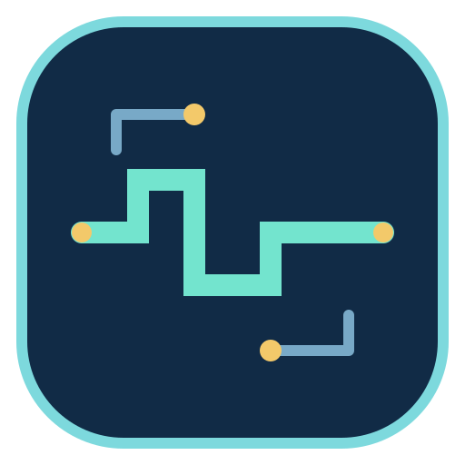

# Digital Rewrite




An early Rust rewrite of [Digital](https://github.com/hneemann/Digital), using PhotoCraft as the architectural source of truth and MaterialCraft as UI inspiration, particularly its node editor. Digital is the behavioral compatibility authority. An early native component editor supports placing, selecting, moving and deleting five component kinds, explicit pin-to-pin wires and undo/redo, plus a bounded one-bit simulator for acyclic circuits of Input, Output, AND, OR and NOT. `.dig` I/O, saving, clipboard, buses, high-Z, sequential components, feedback and Digital compatibility are not implemented. See [parity notes](reimplementation/docs/parity.md).

## Simulation subset

Start (F5) compiles the whole document and, on success, locks editing; Stop (Shift+F5) discards the runtime and restores editing with the document, undo and redo untouched. Step (F10) runs one microstep and pauses settling; Settle (F6) resumes it, and Start or an input toggle also settle automatically in bounded per-frame chunks. Inputs are toggled from the simulation panel, by clicking the Input symbol, or with Space on a selected Input, only while the engine is idle. Connectivity comes from explicit pin-to-pin wires, never from geometry. A net needs exactly one output driver; floating inputs, several drivers and feedback loops are rejected with a located message and leave the editor untouched. Values are one-bit and shown as text (`1 (high)`, `0 (low)`, `? (unavailable)` before a gate has computed them), not only by color. Randomized feedback startup, high-Z, buses and Digital's timing are out of scope. Headless egui tests cover these paths; no native-window validation of the simulation controls was performed.

## Quickstart

Install a Rust toolchain supporting edition 2024, Cargo, and optionally [just](https://just.systems/). A native window system and a wgpu-compatible graphics backend are required; Linux builds also require the usual Wayland/X11 development libraries.

```sh
just run-rust
just build-rust
just check-rust
```

Without just, use `cargo run --locked --manifest-path reimplementation/Cargo.toml`. The existing `just run` still launches the bundled Java reference using its machine-specific Java path. `build_reimplemtation` remains an alias for `build-rust`.

## macOS app bundle

```sh
just bundle-macos     # builds target/bundle/digital-rust.app
just open-macos       # builds if needed, then opens it
just check-bundle-macos
```

`reimplementation/scripts/bundle-macos.sh` (macOS only; requires `jq`, `iconutil`, `codesign`, `plutil`) runs `cargo build --release --locked` (Cargo itself writes to `reimplementation/target`; the script takes the binary and generated-asset paths from Cargo's JSON build messages) and assembles `Contents/MacOS/digital-rust`, `Contents/Info.plist` (version from `reimplementation/Cargo.toml`) and `Contents/Resources/AppIcon.icns`. The icon is derived at bundle time from the build-generated app-icon PNGs through an `.iconset` and `iconutil`; neither PNGs nor `.icns` files are committed. The 512@2x slot is omitted because no 1024 px image is generated. Rerunning replaces the previous bundle. `check-bundle-macos` builds the bundle twice and asserts the executable bit, `plutil -lint`, an `iconutil` round trip of the icon, `codesign --verify`, and that the binary is a Mach-O linking libSystem; no GUI is launched.

The bundle is ad-hoc signed (`codesign --sign -`) so it runs locally; set `CODESIGN_IDENTITY` to use a real identity. It is not notarized, so Gatekeeper may block a copy downloaded or transferred to another Mac. There is no DMG, and the binary targets the host architecture only (no universal binary). The bundle identifier `io.github.digital-rust.editor` and the name `digital-rust` are provisional working names, and `LSMinimumSystemVersion` (11.0) is declared, not tested on older systems.

## Structure and dependencies

The single package in `reimplementation/` contains `domain` (documents and signals), `components` (definitions and simulation), `formats` (file I/O), and `engine` (sessions and commands); component documents, editing history, a pin-net compiler (`simulation`) and a bounded one-bit runtime (`runtime`) are implemented; `sim_text` renders diagnostics for the UI. `ui` is the native adapter and `main.rs` bootstraps it; `symbols` (generated vector data), `symbol_tessellate`, `symbol_render` and `canvas` draw and pick components without involving the engine. Toolkit-independent layers must not depend on the UI.

Published eframe 0.31 supplies egui and wgpu, default fonts, accessibility, and X11/Wayland support. It avoids MaterialCraft's forked egui/winit patch set and widgets. `lyon_tessellation` (pinned to 1.0.23, `std` only) tessellates compound symbol fills and strokes, which epaint's convex-only path fills cannot. XML, automation and HDL dependencies are deferred until their requirements are understood; no compatibility is implied. The lockfile fixes resolved versions.

## Vector assets

Icon and brand artwork is original and authored as SVG with the VectorCraft MCP; sources and provenance are in `reimplementation/assets/` (`icons/manifest.toml` is the inventory). PNGs are never committed: `reimplementation/build.rs` rasterizes the delivery SVGs with `resvg` at build time into `OUT_DIR`, and fails the build for missing or unparsable SVGs, `<text>` elements or aspect-ratio mismatches. `just assets-preview` (requires `jq`) builds and copies the generated PNGs to `target/asset-preview/` for inspection from outside `build.rs`, so previews never invalidate Cargo's inputs; `just check-assets-preview` verifies this. The icons are not yet wired into the UI.

Component symbols (`reimplementation/assets/components/`, inventory in `manifest.toml`) are generated from the committed SVG masters at build time: `build.rs` validates each SVG (anchors on the 20-unit grid, allowed features only, outlined text, black ink), normalizes it with `resvg::usvg` and writes toolkit-neutral vector data (`PathOp`, `SymbolPath`, `SymbolDef`) to `OUT_DIR/component_symbols.rs`, exposed by `src/symbols.rs`. No SVG is parsed at run time. The canvas draws and picks these symbols through `lyon`-tessellated, anti-aliased meshes cached per style, kind and scale bucket; the palette offers a Rectangular (default) / IEEE style toggle. `just symbol-sheet` writes a software-rasterized preview of all ten bindings to `reimplementation/target/symbol-sheet.png`. There is no pan/zoom UI yet.
